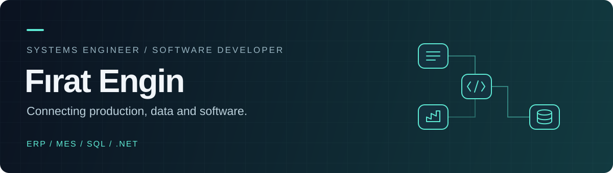

  

  <a href="https://firatengindev.vercel.app/">Portfolio</a> &nbsp; · &nbsp;
  <a href="https://www.linkedin.com/in/firatengin404/">LinkedIn</a> &nbsp; · &nbsp;
  <a href="mailto:fengin7321@gmail.com">Email</a> &nbsp; · &nbsp;
  <a href="https://firatengindev.vercel.app/FiratEnginOzgecmis.pdf">CV</a>

### Turning production data into practical solutions.

I'm **Fırat**, a Computer Engineering graduate and **Systems Engineer at System Handle** since July 2026. I work on digitizing, managing and improving production processes, combining hands-on systems support with software development.

- **Production systems:** Mikro Fly ERP and Prosis MES.
- **Data & reporting:** SQL Server queries, production reports and data-flow analysis.
- **Operations:** Work orders, production operations, inventory movements, system integration and user support.
- **Currently building:** My own MES application for clearer, more user-friendly production monitoring.

---

### What I work on

<table>
  <tr>
    <td width="33%" valign="top">
      <h4>01 / Production systems</h4>
      
Understanding operational problems across ERP and MES, and helping production teams use their systems effectively.

    </td>
    <td width="33%" valign="top">
      <h4>02 / Data & integration</h4>
      
Writing SQL queries and reports, analyzing data flows and supporting connections between business systems.

    </td>
    <td width="33%" valign="top">
      <h4>03 / Software development</h4>
      
Building .NET applications, automation tools and web interfaces that make day-to-day work easier.

    </td>
  </tr>
</table>

### Toolbox

  
  
  
  
  
  
  
  
  

**Business systems:** Mikro Fly ERP · Prosis MES  
**IT foundation:** Active Directory · Windows Server · Group Policy · DHCP / DNS

### Selected work

| Project | Focus | Explore |
| :--- | :--- | :--- |
| **Personal MES application** | Modern, user-friendly production monitoring | In development |
| **Portfolio** | Next.js, TypeScript, Tailwind CSS and Framer Motion | [Website](https://firatengindev.vercel.app/) · [Source](https://github.com/firat404engin/my-portfolio) |
| **Hospital automation** | C# and SQL application | [Repository](https://github.com/firat404engin/Hastane_OtomasyonV2) |
| **Face recognition library automation** | C# Forms and EMGU CV | [Repository](https://github.com/firat404engin/CSharp_and_EMGUCV) |

<b>Türkçe / Hakkımda</b>

Bilgisayar Mühendisliği mezunuyum. Temmuz 2026'dan bu yana **System Handle'da Sistem Mühendisi** olarak üretim süreçlerinin dijitalleştirilmesi, yönetilmesi ve iyileştirilmesi üzerine çalışıyorum.

**Mikro Fly ERP, Prosis MES ve SQL Server** üzerinden iş emirlerini, üretim operasyonlarını, stok hareketlerini ve veri akışlarını analiz ediyorum. SQL sorguları ve raporlamalarla üretim takibini kolaylaştırıyor; sistemler arası entegrasyon ve kullanıcı desteği sağlıyorum.

Üretim takibini daha modern, kullanıcı dostu ve verimli hâle getirmek için **kendi MES uygulamamı geliştiriyorum**.

---

<b>Production systems. Clear data. Useful software.</b> <a href="https://firatengindev.vercel.app/">Explore my portfolio →</a>

